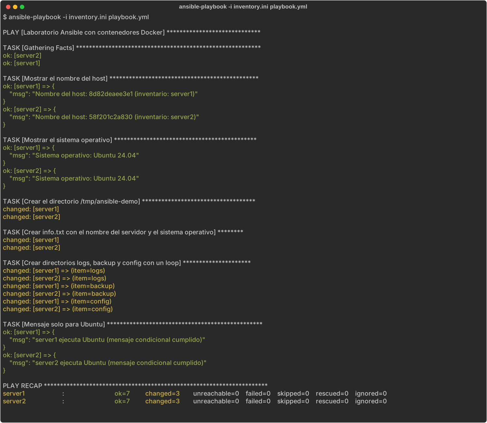

# Laboratorio Ansible + Docker

**Autor:** J. Michael Martinez Almonte — Matrícula 2024-2440

## Objetivo de la práctica

Crear un laboratorio con dos servidores Linux (Ubuntu 24.04) usando contenedores Docker y administrarlos de forma centralizada con Ansible: verificar la conectividad con un inventario y ejecutar un playbook que recopila información de los hosts, crea directorios y archivos, usa un *loop* y una tarea condicional.

## Estructura

```text
ansible-lab/
├── docker-compose.yml   # Define server1 y server2 (ubuntu:24.04)
├── inventory.ini        # Inventario con conexión tipo docker
├── playbook.yml         # Tareas a ejecutar en ambos servidores
└── README.md
```

## Requisitos

- Docker y Docker Compose
- Ansible (`pip install ansible`)

## 1. Iniciar los contenedores

```bash
docker compose up -d
docker ps
```

Instalar Python en cada contenedor (Ansible lo necesita en el host administrado):

```bash
docker exec -it server1 bash -c "apt update && apt install -y python3"
docker exec -it server2 bash -c "apt update && apt install -y python3"
```

## 2. Comprobar la conexión

```bash
ansible docker -i inventory.ini -m ping
```

## 3. Ejecutar el playbook

```bash
ansible-playbook -i inventory.ini playbook.yml
```

### ¿Qué hace el playbook?

| Tarea | Módulo |
|---|---|
| Mostrar el nombre del host | `debug` |
| Mostrar el sistema operativo | `debug` |
| Crear `/tmp/ansible-demo` | `file` |
| Crear `info.txt` con el nombre del servidor y el SO | `copy` |
| Crear `logs`, `backup` y `config` mediante un loop | `file` + `loop` |
| Mostrar un mensaje solo si el SO es Ubuntu | `debug` + `when` |

Verificación del resultado:

```bash
docker exec server1 cat /tmp/ansible-demo/info.txt
docker exec server1 ls /tmp/ansible-demo
```

## Captura de la ejecución exitosa



## Detener el laboratorio

```bash
docker compose down
```
